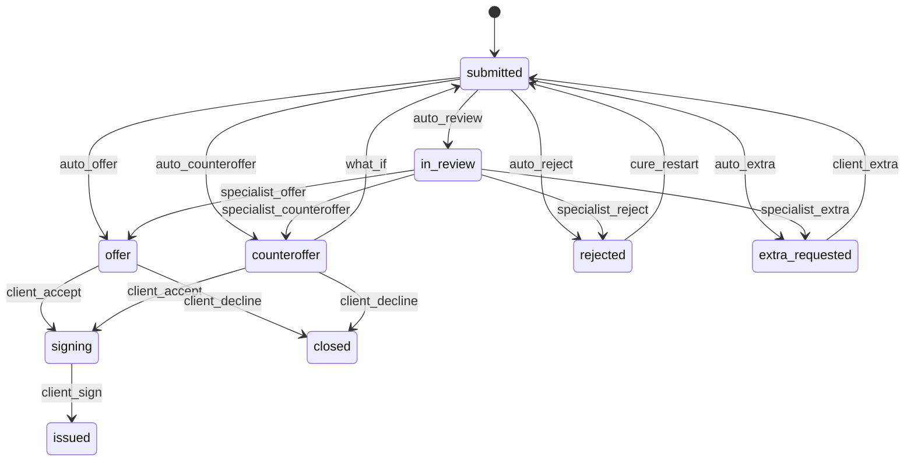

# Умный кредитный кабинет предпринимателя

Цифровой кредитный конвейер для **действующих клиентов** малого и микробизнеса: от задачи бизнеса до смоделированной выдачи. Клиентский кабинет и обработка банка живут в одном веб-приложении.

## Зачем это

Предприниматель не выбирает продукт из каталога и не перебивает реквизиты, которые банк уже знает. Система рекомендует «Кассу» или «Развитие», проводит стоп-факторы, считает **скоринг** и отдельно применяет **кредитную политику**. Исход не бинарный: оферта, встречные условия, дозапрос или отказ — всегда на той же заявке.

«Касса» — оборотный экспресс-кредит под поступления, с графиком платежей. Это не овердрафт.

## Быстрый запуск

Нужны Docker Desktop и ~12 ГБ RAM.

```bash
docker compose up --build
```

Откройте [http://localhost:8080](http://localhost:8080). API и Swagger: [http://localhost:8000/docs](http://localhost:8000/docs).

Локально без Docker (SQLite):

```bash
cd backend && python3 -m venv .venv && source .venv/bin/activate
pip install -r requirements.txt
uvicorn app.main:app --reload --port 8000

# другой терминал
cd frontend && npm install && npm run dev
```

Кабинет: [http://localhost:5173](http://localhost:5173). Если меняли сид, удалите `backend/cabinet.db` — очередь специалиста создаётся при старте.

## Демо-учётки

| Логин | Пароль  | Кто |
|-------|---------|-----|
| `ip`  | `ip123` | ИП Волков, пекарня «Восход», чистые обороты |
| `ooo` | `ooo123` | ООО «ТехноСнаб», налоговая задолженность, можно Cure |
| `spec` | `spec123` | кредитный специалист Морозова, очередь сразу живая |

Код подписания в интерфейсе: **123456**. SMS нет.

## Сценарий проверки, 10 минут

1. Войти как `spec`. Вкладка «Нужно решение» не пустая: пекарня, «Развитие», цель «Вторая печь и ремонт точки на Таганке». Кнопки живые. В досье — ИНН, ОКВЭД, оборот, график, DSCR, risk memo.
2. Выйти, войти как `ip`. На дашборде «Доступно в «Кассе»» ~1,25 млн ₽. Приветствие зависит от времени суток.
3. Новая заявка → «Кассовый разрыв». Слайдер шагает по 10 000 ₽, рядом платёж в месяц. Отправить — 1–2 сек идут шаги ЕГРЮЛ / ФНС / БКИ. Статус: **готово предложение**.
4. Принять → «Условия и график платежей» → код `123456` → **деньги на счёте**. Лимит «Кассы» падает на сумму выдачи.
5. Ещё одна «Касса» на 800 000. Скоринг учитывает уже выданный долг. Вторая выдача режет доступный остаток.
6. Заявка на «Кассу» с суммой **2 250 000**. Статус: **встречные условия**. Блок «Как взять запрошенную сумму?»: выписка из другого банка поднимает лимит до запроса.
7. Заявка «Рост и оборудование» с текстом цели. Статус: **рассматриваем**.
8. Войти как `ooo`, «Касса». Автоотказ по налогам. Кнопка «Смоделировать погашение налога» — та же заявка уходит специалисту, скоринг растёт.
9. Тумблер в шапке «Сбой БКИ»: следующая заявка ИП уходит в очередь с правилом `fallback:bki_timeout`.

## Состояния заявки



## Что внутри конвейера

1. Стоп-факторы: статус в реестре, блок счёта, налоги, просрочка БКИ.
2. Балльный скоринг 0–100: стаж, сумма к обороту **с учётом наших выдач**, стабильность оборотов, БКИ.
3. Политика: «Касса» в лимите и с нормальным скорингом закрывается автоматом; выше лимита — встречка; пограничный скоринг, сбой БКИ, устаревший профиль или «Развитие» — специалист.
4. Лимит «Кассы» = 50% среднего оборота минус уже выданное, от 300 тыс. до 15 млн, шаг 10 000 ₽.

Скоринг не равен решению. На карточке специалиста виден путь сработавших правил.

## Стек

- React + Vite + Tailwind CSS v4
- FastAPI + SQLModel + PostgreSQL
- Docker Compose

ИИ и OCR в поставку не входят: заказчик не даёт за них баллов, логика должна быть проверяемой.

## Тесты

```bash
cd backend && .venv/bin/python -m pytest -q
```

## Документация в репозитории

- [docs/architecture.md](docs/architecture.md)
- [docs/data-model.md](docs/data-model.md)
- [docs/state-machine.md](docs/state-machine.md)
- [docs/assumptions.md](docs/assumptions.md)
- [docs/openapi.json](docs/openapi.json)
- [docs/http/conveyor.http](docs/http/conveyor.http)
- [THIRD_PARTY_NOTICES](THIRD_PARTY_NOTICES)

Переменные окружения: `.env.example`. Ключевая ставка по умолчанию `16.5` — ориентир рынка на дату кейса, спреды считаются от неё.
