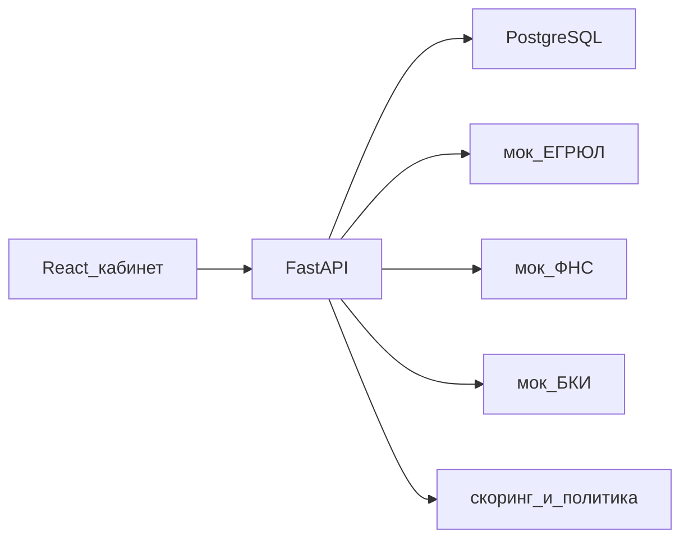
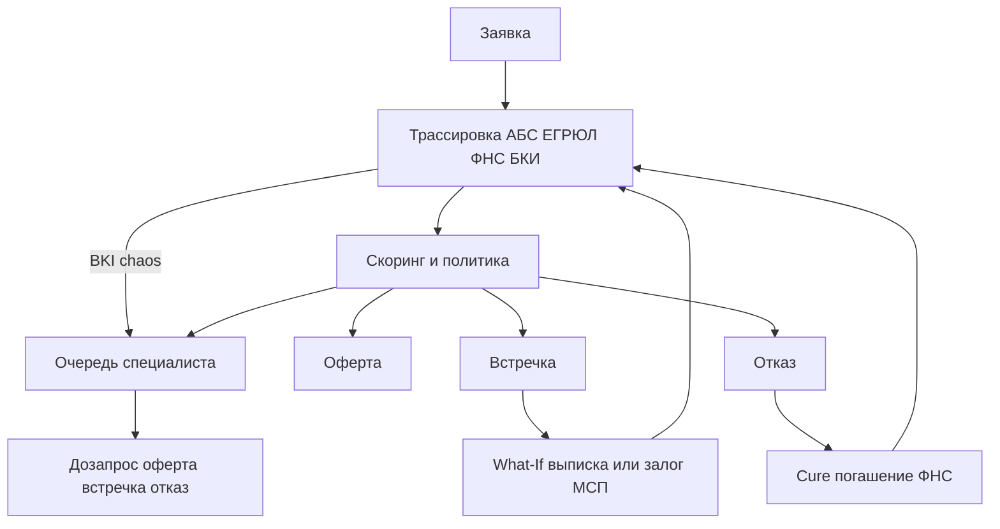

# Архитектура

Клиентский кабинет и кабинет специалиста — одно SPA, две роли, JWT.

Слои API:

- `routers` — HTTP и права
- `services` — оркестрация заявки
- `domain` — продукты, скоринг, политика, state machine без I/O
- `adapters` — контракты внешних источников на словаре ИНН

Каждое автоматическое решение пишется снимком: enrichment + scoring + policy.rules + pipeline. Клиенту отдаётся человеческий статус, `client_message` и шаги проверок. Скоринг и правила — только специалисту.

