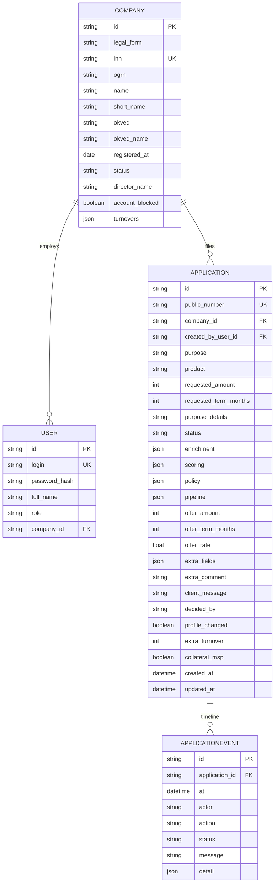

# Модель данных

- `company` — действующий клиент банка: реквизиты, обороты за 6 месяцев, блок счёта.
- `user` — `ip` / `ooo` (role=client) и `spec` (role=specialist).
- `application` — заявка: цель, продукт, суммы, статус, JSON-снимки enrichment/scoring/policy/pipeline, оферта, поля дозапроса, флаги `profile_changed`, `extra_turnover`, `collateral_msp`.
- `applicationevent` — таймлайн. Клиенту видны `message`, специалисту ещё `detail`.

Идентификаторы UUID. Публичный номер `APP-2026-NNNN`. Деньги — целые рубли, шаг суммы 10 000 ₽.

